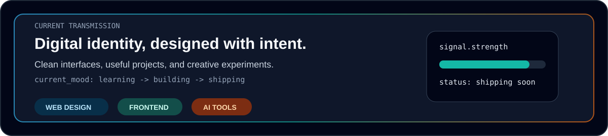
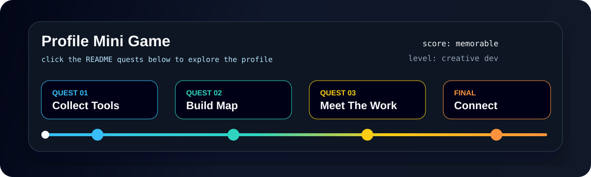
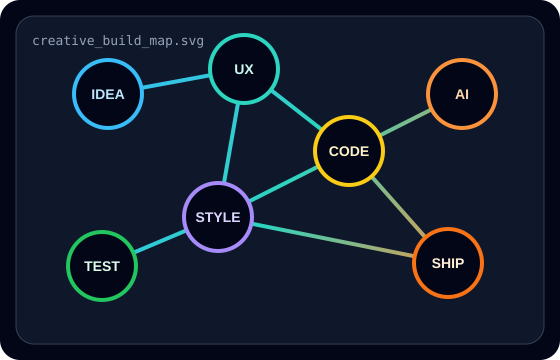
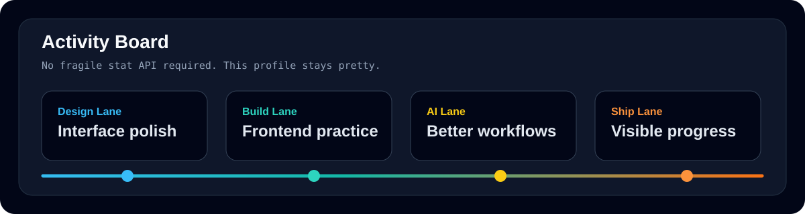

<div align="center">


<br />

<a href="https://github.com/josntndr">
  
</a>
<a href="https://github.com/josntndr?tab=followers">
  
</a>
<a href="https://josephinesantander.vercel.app">
  
</a>

</div>

## Welcome To My Buildverse

I design with clean structure, code with curiosity, and use AI tools to turn ideas into polished digital work. This profile is my live creative board: part portfolio, part dev journal, part tiny arcade.

## Studio Signal



```txt
Name        Josephine Santander
Handle      josntndr
Campus      FEU Institute of Technology
Location    Imus, Cavite, Philippines
Mode        Designing clean interfaces and building practical web projects
```

## Profile Mini Game



<details open>
  <summary><strong>Start Game: Choose your quest</strong></summary>
  <br />
  <table>
    <tr>
      <td align="center" width="33%">
        <a href="#creative-stack"><strong>Collect Tools</strong></a>
        <br />
        Unlock the stack I use to build interfaces.
      </td>
      <td align="center" width="33%">
        <a href="#build-map"><strong>Enter The Build Map</strong></a>
        <br />
        Follow how ideas move from spark to shipped project.
      </td>
      <td align="center" width="33%">
        <a href="#connect"><strong>Open Final Portal</strong></a>
        <br />
        Visit my portfolio or connect with me.
      </td>
    </tr>
  </table>
</details>

<details>
  <summary><strong>Secret Level: Why this profile exists</strong></summary>
  <br />
  I am learning in public and turning my GitHub into a place that feels alive: visual, useful, and easy for visitors to remember.
</details>

## Creative Stack

<div align="center">


</div>

## Build Map



I am growing as a web designer and creative developer by turning ideas into clean, usable digital projects. My favorite space is where layout, interaction, and AI-assisted workflows meet.

Right now I am focused on frontend fundamentals, responsive design, portfolio projects, and building a GitHub presence that feels personal instead of generic.

## Project Energy

<table>
  <tr>
    <td width="33%" align="center">
      <h3>Interface Design</h3>
      <p>Clean pages, readable sections, thoughtful spacing, and visual systems that feel easy to use.</p>
    </td>
    <td width="33%" align="center">
      <h3>AI Workflow</h3>
      <p>Using modern tools for planning, writing, prototyping, and building faster with more clarity.</p>
    </td>
    <td width="33%" align="center">
      <h3>Creative Builds</h3>
      <p>Profile skins, portfolios, small apps, digital assets, and experiments with personality.</p>
    </td>
  </tr>
</table>

## Activity Board

<div align="center">



</div>

## Connect

<div align="center">

<a href="https://github.com/josntndr">
  
</a>
<a href="https://josephinesantander.vercel.app">
  
</a>
<a href="https://www.linkedin.com/in/josephine-santander-796883357">
  
</a>

</div>

---

<div align="center">
  <strong>Designing with intention. Building with curiosity. Shipping one polished commit at a time.</strong>
</div>
