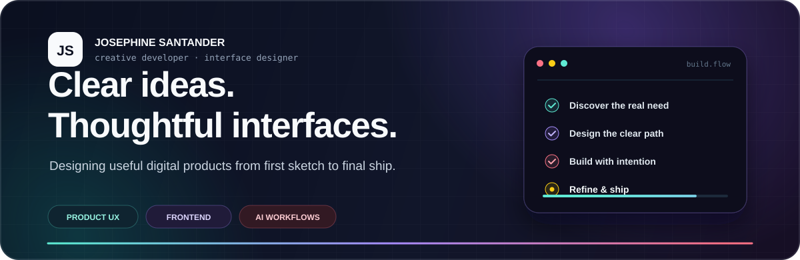
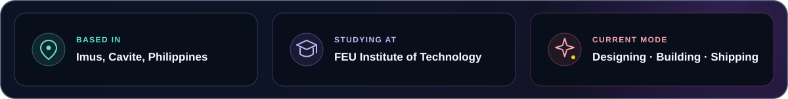

 

## Hello, I'm Josephine

I’m a creative developer and interface designer from the Philippines, turning ideas into useful digital products through thoughtful UX, clean frontend work, and AI-assisted workflows.

## Leadership

## Creative Toolkit

<strong>FRONTEND &amp; INTERFACE</strong>
  

 

<strong>BACKEND &amp; DATA</strong>
  

 

<strong>DESIGN &amp; WORKFLOW</strong>
  

## How I Build

<table>
  <tr>
    <td width="33%" align="center"><strong>01 · Discover</strong> Understand the problem and the people using it.</td>
    <td width="33%" align="center"><strong>02 · Design</strong> Shape a clear flow and a focused visual system.</td>
    <td width="33%" align="center"><strong>03 · Deliver</strong> Build, test, refine, and ship the useful version.</td>
  </tr>
</table>

### Let’s make something useful.

<a href="https://josephinesantander.vercel.app"><strong>Portfolio</strong></a> · <a href="https://github.com/josntndr"><strong>GitHub</strong></a> · <a href="https://www.linkedin.com/in/josephine-santander-796883357"><strong>LinkedIn</strong></a>

Designing with intention, learning with curiosity, and growing through every experience.

